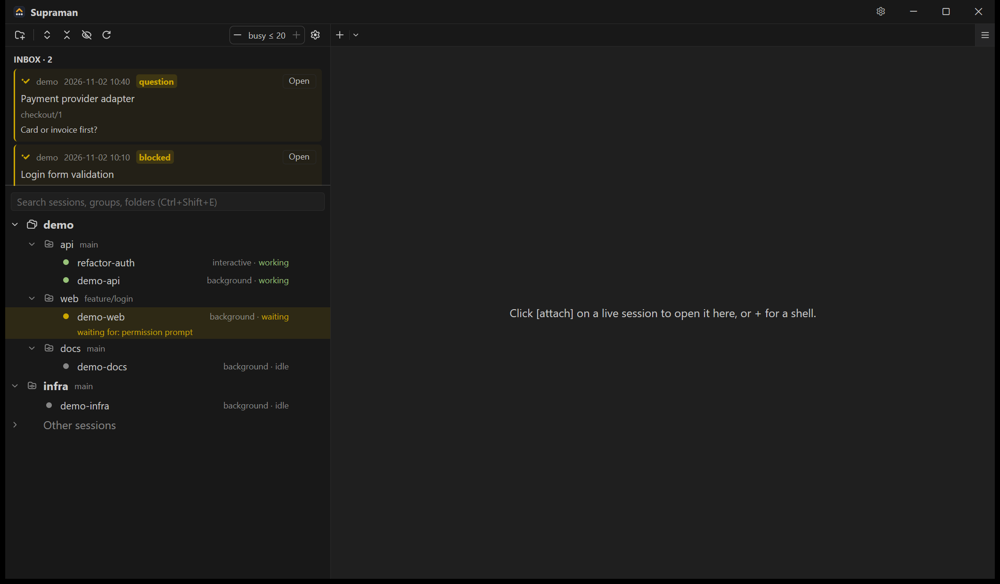
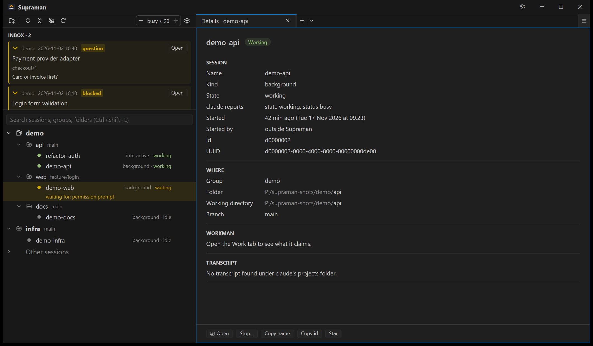

<picture>
  <source media="(prefers-color-scheme: dark)" srcset="crates/supraman-app/assets/brand/lockups/supraman-lockup-on-dark.svg">
  
</picture>

**Supraman** is a Windows desktop app for running several Claude Code sessions at once. You list the folders you
work in, alone or in groups. It shows every Claude Code session on the machine under the folder it runs in, opens
any of them in a terminal tab, and puts whatever needs you in one Inbox. A repository gets a Git tab, and with
Workman a folder or group gets a Work tab. It is for developers who already use Claude Code's `claude` CLI and
have more sessions than terminal windows. Supraman runs on your machine and is open source (GPL-3.0-or-later).





*The screenshots show fixture data: `supraman.exe --selftest-shots` makes them on a hidden desktop.*

## What it does

- **Folders and groups.** The sidebar lists the folders you add, at the top level or in a group. A folder's
  **Show sub folders** lists its sub folders as rows of their own, and **Exclude Folder** leaves one of them out.
  A session shows under the deepest listed folder that holds its working folder; the rest show under
  **Other sessions**.
- **Sessions.** Every Claude Code session on the machine, background and interactive, with its state (working,
  waiting, idle, interrupted, stopped, closed) and a Details tab. **Open** attaches to a running session in a
  terminal tab or resumes a stopped one.
- **Tabs.** On a folder, **New claude here** starts `claude` in a tab, **Open terminal here** a shell, and
  **New task…** a prompt that starts a session with it. **+** opens a shell; its menu picks one of the
  machine's shells (PowerShell, cmd, a Developer prompt, a WSL distro).
- **One Inbox.** The Workman items that need you (a question, a blocked task), a scheduled run that failed, and a
  schedule waiting for your approval.
- **Git tab.** **Open Git** on a repository's folder: the commit graph with its branches, tags, stashes, other
  worktrees and the sessions working in them; a commit's message and files; a file's diff side by side or inline.
  It writes too: stage, unstage and discard files, hunks or lines; commit and amend; create, rename, check out and
  delete branches and tags; merge, rebase, cherry-pick, revert and reset; resolve conflicts; stash and pop; fetch,
  pull and push; add remotes and worktrees. **Undo** and **Redo** take back a commit, a checkout, a discard and
  the like. It fetches in the background and follows the repository as it changes.
- **Work tab.** **Open Work** on a folder or group: its Workman projects, their runs and items with their
  criteria and evidence, and the latest activity. It only reads; your sessions write to Workman.
- **Schedules.** Recurring work that runs on this machine (a slash command or a prompt, with a permission profile
  and caps), listed under its folder. Nothing runs until you click **Approve** on the schedule's page.
- **Workman.** Sign in once and every session Supraman launches gets its own Workman token.
- **`sm`**, a command-line tool for the same things: `sm folder add <dir>`, `sm group add <name>`,
  `sm sessions`, `sm schedule …`; `sm --help` lists them all.

## Install

**Requirements**

- Windows 10 or 11, x64.
- Claude Code's `claude` CLI on your `PATH`, version 2.1.308 or newer. Supraman is tested with 2.1.310; it
  refuses an older CLI and runs a newer one, with a warning in the toolbar when the minor version is newer than
  the tested one ([version policy](docs/RELEASE.md#claude-cli-version-policy)).
- For the Git tab, git 2.36 or newer on your `PATH` (Git for Windows).
- PowerShell for terminal tabs: **+** and **Open terminal here** start PowerShell 7 (`pwsh`) when it is on your
  `PATH`, else the Windows PowerShell that comes with Windows. Supraman looks once, at start: a `pwsh` installed
  while it runs is used after a restart.

**Steps**

1. Download `Supraman-<version>.zip` from [GitHub Releases](https://github.com/getsupraman/supraman/releases).
2. Unblock it: right-click the zip, **Properties**, tick **Unblock**. The exes are not code-signed, so Windows
   SmartScreen may still ask on the first start.
3. Extract it anywhere, for example `C:\Tools\supraman`. There is no installer.
4. Run `supraman.exe` from that folder.

Supraman keeps its state in `%APPDATA%\Supraman` (or in the folder `SUPRAMAN_HOME` names), never in the install
folder.

## First steps

1. **Add a folder.** The window starts empty. Click the folder button at the top of the left panel:
   **Add Folder…** picks a folder and **Add Group…** names a group; a group's own **Add Folder…** puts a folder
   in it. Drag a folder's row to move it. From a shell: `sm folder add <dir>` and `sm group add <name>`.
2. **Open a session.** Click **New claude here** on a folder, or **+** for a shell and run `claude` in it, or open
   a running session from the tree. Sessions you start elsewhere show up in the tree too.
3. **Sign in to Workman** (optional): **Settings → Workman → Sign in** opens your browser. Without it everything
   but the Work tab works, and sessions run without Workman.
4. **Schedule work** (optional): **New scheduled task…** on a folder asks a session to set it up; the plugin's
   `/supraman:supraman-scheduler` skill adds it with `sm schedule add`. It shows under its folder as pending until
   you click **Approve**.

## Updating

Supraman checks GitHub Releases at start and once a day. When a newer release is out it shows
"Supraman *version* is available"; **Update** downloads it, checks it against the release's signed manifest
(ed25519), replaces the install and restarts. Sessions keep running in the background meanwhile. Turn
**Check for updates** off in **Settings → About**. How it works:
[docs/RELEASE.md](docs/RELEASE.md#how-supraman-updates-itself).

## Build from source

The toolchain is pinned in [rust-toolchain.toml](rust-toolchain.toml); `rustup` installs it on the first build.

```powershell
cargo build --release --workspace
target\release\supraman.exe
```

- Tests: `cargo test --release --workspace`.
- Selftests: `target\release\supraman.exe --selftest` drives the real app on a hidden desktop of its own, so
  you can keep typing while it runs. It needs the `claude` CLI and launches one short session of its own.
- A release folder and zip: `scripts\release.ps1` ([docs/RELEASE.md](docs/RELEASE.md)).
- How the crates fit together: [docs/ARCHITECTURE.md](docs/ARCHITECTURE.md); the keys: [docs/KEYS.md](docs/KEYS.md).

The app is a native Rust app built on [gpui](https://github.com/zed-industries/zed).

## Roadmap

Supraman runs on Windows today. GitMan is its Git tab; next comes **FileMan**, then macOS and Linux. What is
Windows-only, and what takes its place on each platform: [docs/ROADMAP.md](docs/ROADMAP.md).

## Family

- **Supraman**: runs and watches your Claude Code sessions (this repository).
- **Workman**: the work tracker your sessions plan and report in
  ([github.com/getsupraman/workman](https://github.com/getsupraman/workman)). Supraman shows its projects in the
  Work tab and the items that need you in the Inbox.
- **GitMan**: the Git tab, part of Supraman.
- **FileMan**: planned.

## Licence

GPL-3.0-or-later: [LICENSE](LICENSE). Third-party code and assets with their licences:
[THIRD_PARTY.md](THIRD_PARTY.md). The Supraman marks under `crates/supraman-app/assets/brand` come from the
Supraman brand kit; see [its notice](crates/supraman-app/assets/brand/NOTICE.md).

## Contributing

Issues and pull requests are welcome. Every commit needs a `Signed-off-by:` line (`git commit -s`, the Developer
Certificate of Origin); [CONTRIBUTING.md](CONTRIBUTING.md) has that and the rules for new dependencies.
