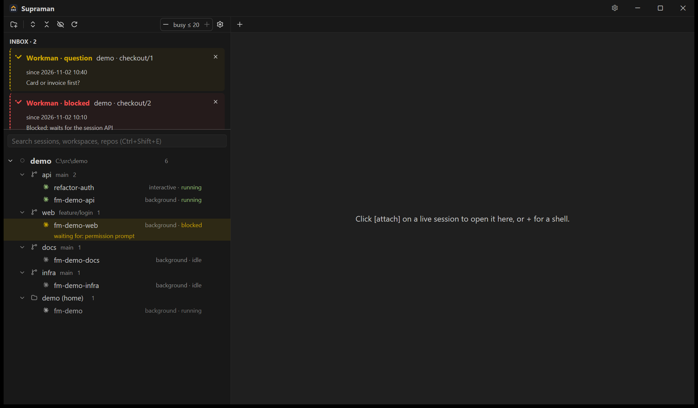
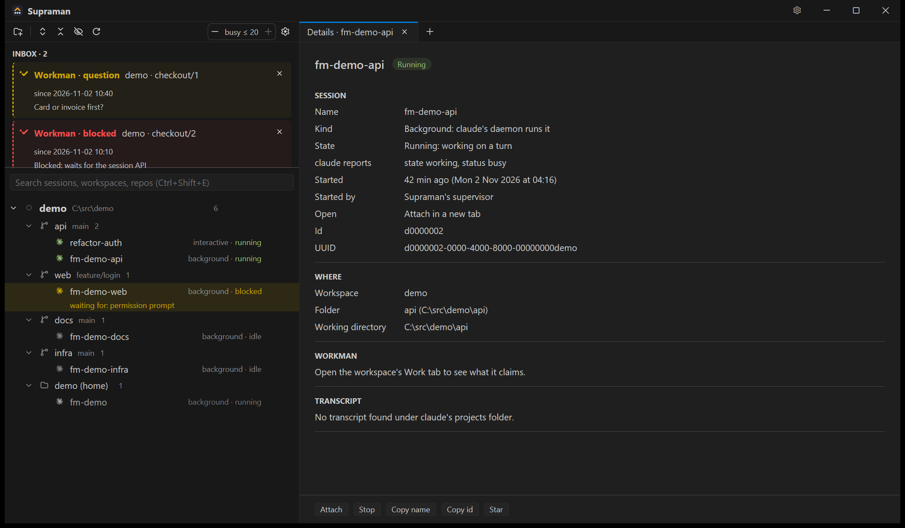

<picture>
  <source media="(prefers-color-scheme: dark)" srcset="crates/supraman-app/assets/brand/lockups/supraman-lockup-on-dark.svg">
  
</picture>

**Supraman** is a Windows desktop app for running several Claude Code sessions at once. You give it the folders
you work in. It keeps the sessions each workspace wants running, lists every Claude Code session on the machine
by workspace and folder, and puts whatever needs you in one Inbox. You can open any session in a terminal tab.
It is for developers who already use Claude Code's `claude` CLI and have more sessions than terminal windows.
Supraman runs on your machine and is open source (GPL-3.0-or-later).





*The screenshots show fixture data: `supraman.exe --selftest-shots` makes them on a hidden desktop.*

## What it does

- **Supervises sessions.** A workspace says which sessions it wants. Supraman launches them with `claude --bg`,
  resumes a stopped one, and reports one that fails to start.
- **Shows every session.** All Claude Code sessions on the machine, background and interactive, grouped by
  workspace and folder, with their state (running, blocked, idle, stopped) and a Details tab for each.
- **One Inbox.** A session waiting on a permission prompt, a question a session sent you, a launch that failed,
  a blocked task in Workman, a scheduled run that failed.
- **Terminal tabs.** Attach to a session in a tab, or open a new one with **+**.
- **Schedules.** Recurring work that runs on this machine (a slash command or a prompt, with a permission
  profile and caps). Nothing runs until you approve it in the window.
- **Workman.** Sign in once and every session Supraman launches gets its own Workman token, and the Inbox shows
  the work items that need you.
- **`sm`**, a command-line tool for the same things: `sm workspace add <dir>`, `sm sessions`, `sm schedule …`,
  `sm --help` for the rest.

## Install

**Requirements**

- Windows 10 or 11, x64.
- Claude Code's `claude` CLI on your `PATH`, version 2.1.308 or newer. Supraman is tested with 2.1.310; it
  refuses an older CLI and runs a newer one, with a warning in the toolbar when the minor version is newer than
  the tested one ([version policy](docs/RELEASE.md#claude-cli-version-policy)).
- PowerShell 7 (`pwsh`) on your `PATH` for terminal tabs: **+** and "Open terminal here" start `pwsh`.

**Steps**

1. Download `Supraman-<version>.zip` from [GitHub Releases](https://github.com/getsupraman/supraman/releases).
2. Unblock it: right-click the zip, **Properties**, tick **Unblock**. The exes are not code-signed, so Windows
   SmartScreen may still ask on the first start.
3. Extract it anywhere, for example `C:\Tools\supraman`. There is no installer.
4. Run `supraman.exe` from that folder.

Supraman keeps its state in `%APPDATA%\Supraman` (or in the folder `SUPRAMAN_HOME` names), never in the install
folder.

## First steps

1. **Add a workspace.** The window starts empty. Click the folder button at the top of the left panel and pick a
   folder that holds your repositories; Supraman finds the git repos in it. From a shell:
   `sm workspace add <dir>`.
2. **Open a session.** Click **+** for a `pwsh` tab and run `claude` in it, or attach to a running session from
   the tree. Sessions you start elsewhere show up in the tree too.
3. **Sign in to Workman** (optional): **Settings → Workman → Sign in** opens your browser. Without it everything
   above works, and sessions run without Workman.
4. **Schedule work** (optional): ask a session to schedule something; the plugin's `/supraman:supraman-scheduler`
   skill adds it with `sm schedule add`. It shows in the Schedules group as pending until you click **Approve**.

## Updating

Supraman checks GitHub Releases at start and once a day. When a newer release is out it shows
"Supraman *version* is available"; **Update** downloads it, checks it against the release's signed manifest
(ed25519), replaces the install and restarts. Sessions keep running in the background meanwhile. Turn the
check off in **Settings → About**. How it works: [docs/RELEASE.md](docs/RELEASE.md#how-supraman-updates-itself).

## Build from source

The toolchain is pinned in [rust-toolchain.toml](rust-toolchain.toml); `rustup` installs it on the first build.

```powershell
cargo build --release --workspace
target\release\supraman.exe
```

- Tests: `cargo test --release --workspace`.
- Selftests: `target\release\supraman.exe --selftest` drives the real app on a hidden desktop of its own, so
  you can keep typing while it runs. It needs the `claude` CLI and launches one short session of its own.
- A release folder and zip: `scripts\release.ps1` ([docs/RELEASE.md](docs/RELEASE.md)).
- How the crates fit together: [docs/ARCHITECTURE.md](docs/ARCHITECTURE.md).

The app is a native Rust app built on [gpui](https://github.com/zed-industries/zed).

## Roadmap

Supraman runs on Windows today. Next come **Gitman** and **Fileman**, then macOS and Linux. What is Windows-only,
and what takes its place on each platform: [docs/ROADMAP.md](docs/ROADMAP.md).

## Family

- **Supraman**: runs and watches your Claude Code sessions (this repository).
- **Workman**: the work tracker your sessions plan and report in
  ([github.com/getsupraman/workman](https://github.com/getsupraman/workman)). Supraman shows its board and Inbox.
- **Gitman** and **Fileman**: planned.

## Licence

GPL-3.0-or-later: [LICENSE](LICENSE). Third-party code and assets with their licences:
[THIRD_PARTY.md](THIRD_PARTY.md). The Supraman marks under `crates/supraman-app/assets/brand` come from the
Supraman brand kit; see [its notice](crates/supraman-app/assets/brand/NOTICE.md).

## Contributing

Issues and pull requests are welcome. Every commit needs a `Signed-off-by:` line (`git commit -s`, the Developer
Certificate of Origin); [CONTRIBUTING.md](CONTRIBUTING.md) has that and the rules for new dependencies.
